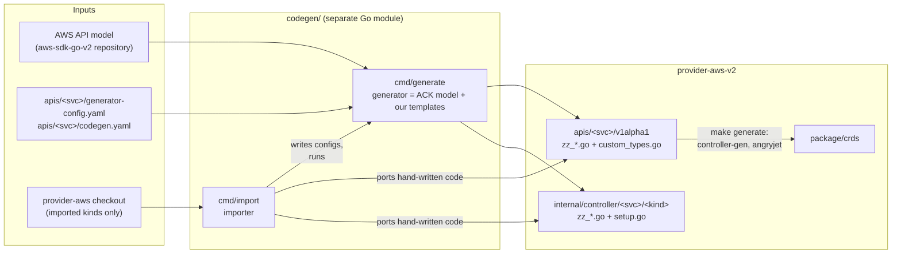
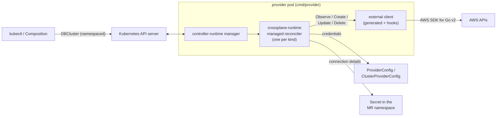
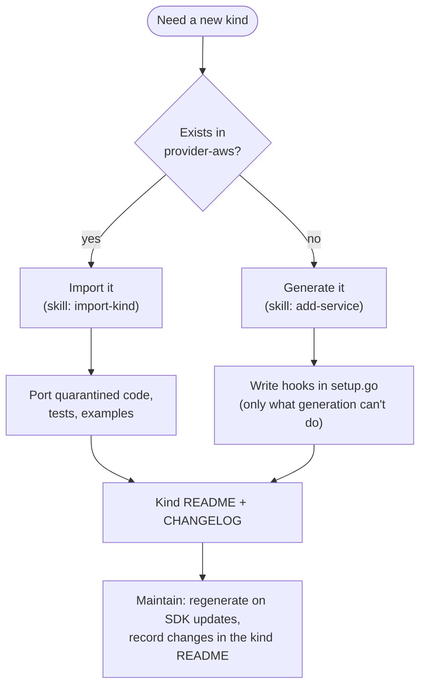

# Architecture

This page is the entry point to the design of provider-aws-v2. It gives the
big picture and links to one page per component and one record per design
decision. For the daily workflow see [development.md](development.md).

## What it is

provider-aws-v2 is a native (no Terraform) [Crossplane](https://crossplane.io)
v2 provider for AWS. A Kubernetes user creates a managed resource such as a
`DBCluster` in a namespace; a controller of the provider creates, updates
and deletes the matching AWS resource through the AWS SDK for Go v2 and
reports its state back.

Goals:

- **Crossplane v2 only**: crossplane-runtime v2, namespaced managed resources,
  connection details only as local Secrets ([ADR 0002](adr/0002-namespaced-resources-only.md)).
- **Generated, not hand-typed**: API types and the controller skeleton of
  every kind come from the AWS API models
  ([ADR 0003](adr/0003-ack-code-generator-as-a-library.md)), so a new kind or an
  AWS API change costs little.
- **Reuse proven logic**: the hand-written behavior of
  [crossplane-contrib/provider-aws](https://github.com/crossplane-contrib/provider-aws)
  is imported per kind, only for the kinds that are needed
  ([ADR 0004](adr/0004-import-kinds-from-provider-aws.md)).
- **Side by side with provider-aws**: own API group `*.aws2.crossplane.io`
  ([ADR 0001](adr/0001-new-native-provider-for-crossplane-v2.md)).

Status: proof of concept. Kinds: see the READMEs under
`internal/controller/<service>/<kind>/`.

## Big picture

Two halves: **build time** turns AWS API models (and, for imported kinds,
provider-aws code) into Go code and CRDs; **run time** is a normal
controller-runtime manager.

## Components

Each page explains what the component is, why it is used, how this
repository uses it, and its pitfalls.

| Component | Role | Page |
|-----------|------|------|
| AWS SDK for Go v2 and API models | Runtime client; source of truth for shapes and operations | [aws-sdk.md](components/aws-sdk.md) |
| ACK code-generator | Library that turns an API model + `generator-config.yaml` into a CRD model and field-mapping code | [ack-code-generator.md](components/ack-code-generator.md) |
| Code generator (`codegen/cmd/generate`) | Renders our templates: API types, controllers, conversions, registries | [code-generator.md](components/code-generator.md) |
| Importer (`codegen/cmd/import`) | Ports kinds and their hand-written code from provider-aws | [importer.md](components/importer.md) |
| controller-gen (kubebuilder markers) | Deepcopy and CRD YAML from Go types | [controller-gen.md](components/controller-gen.md) |
| angryjet (crossplane-tools) | Managed-resource methods and reference resolvers | [angryjet.md](components/angryjet.md) |
| crossplane-runtime v2 | Managed reconciler that drives the external client | [crossplane-runtime.md](components/crossplane-runtime.md) |
| ProviderConfig and AWS credentials | Turns a `(Cluster)ProviderConfig` into an `aws.Config` | [provider-config.md](components/provider-config.md) |
| Testing | Unit tests with SDK fakes, envtest, generator tests | [testing.md](components/testing.md) |
| Build and packaging | Make, build submodule, image, xpkg, local cluster | [build.md](components/build.md) |

## Where code comes from

Every kind is a mix of generated and hand-written code. The split is fixed
by file name: `zz_*` files are generated and never edited; everything else
is hand-written and survives regeneration.

| Path | Origin |
|------|--------|
| `apis/<svc>/v1alpha1/zz_*.go` | code generator (types, enums) |
| `apis/<svc>/v1alpha1/zz_generated.*.go` | controller-gen (deepcopy), angryjet (managed methods, resolvers) |
| `apis/<svc>/v1alpha1/custom_types.go`, other `*.go` | hand-written (created empty by the generator or by the importer) |
| `internal/controller/<svc>/<kind>/zz_controller.go`, `zz_conversions.go` | code generator |
| `internal/controller/<svc>/<kind>/setup.go` | hand-written hooks (imported or new) |
| `internal/controller/<svc>/<kind>/README.md` | hand-written: origin, behavior, limits, history of the kind |
| `internal/clients/<svc>`, `internal/utils/*` | hand-written helpers (mostly imported) |
| `package/crds` | controller-gen |

The order of the generation steps matters:
`make services` → `make generate` → `go build`. See
[code-generator.md](components/code-generator.md#generation-order).

## Life of a kind

## Design decisions

Decisions and their reasons are recorded as ADRs in [adr/](adr/README.md).
Read them before changing anything they cover; write a new one when you make
a decision of similar weight.

## Further reading

- [development.md](development.md): workflow, conventions, definition of done.
- [porting-notes.md](porting-notes.md): pitfalls when porting provider-aws code.
- [`AGENTS.md`](../AGENTS.md): condensed rules for AI coding agents.
