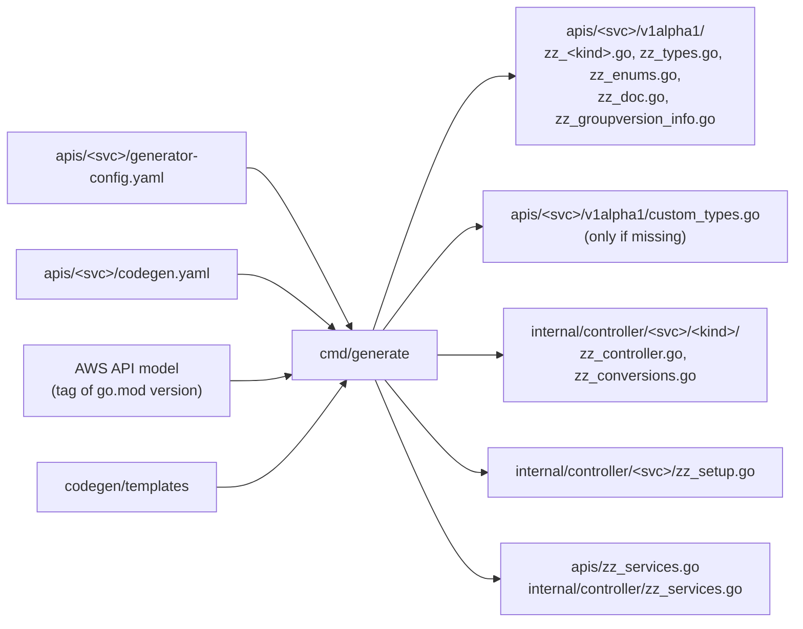
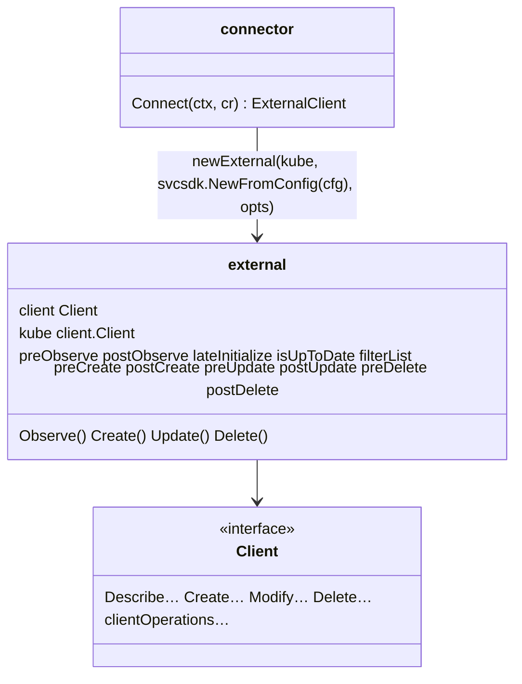
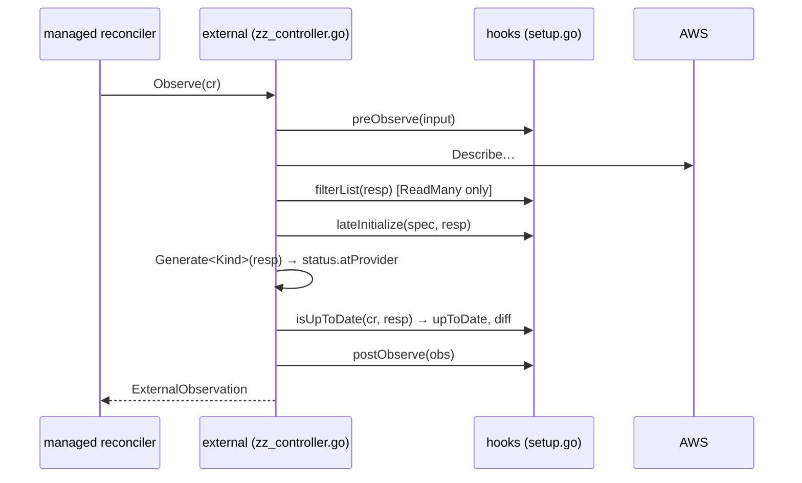
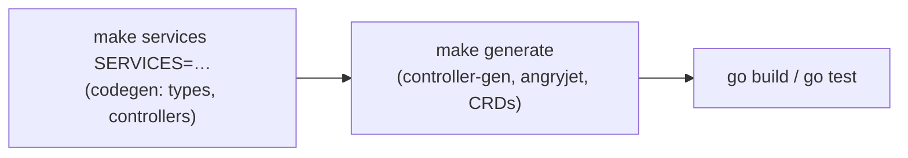

# Code generator (`codegen/cmd/generate`)

## What it is

Our generator: it loads a service with the
[ACK code-generator](ack-code-generator.md) and renders **our own templates**
(`codegen/templates`) for crossplane-runtime v2, namespaced managed
resources and AWS SDK v2. It lives in the separate Go module `codegen/`, so
its dependencies (ACK, the SDK v1 model loader) never reach the provider.

## Why

ACK's templates target the ACK runtime. Crossplane needs different types
(`spec.forProvider`, `status.atProvider`, `ManagedResourceSpec`), a
different controller (`managed.ExternalClient`) and extension points for
hand-written code. Owning the templates keeps that under our control while
ACK does the model work ([ADR 0003](../adr/0003-ack-code-generator-as-a-library.md)).

## Inputs and outputs



| Template | Output |
|----------|--------|
| `apis/crd.go.tpl` | `zz_<kind>.go`: `<Kind>Parameters` (embeds `Custom<Kind>Parameters`), `<Kind>Observation`, spec/status, kubebuilder markers |
| `apis/types.go.tpl`, `enums.go.tpl` | shared structs and enums of the service |
| `apis/doc.go.tpl`, `groupversion_info.go.tpl` | package doc, `<svc>.aws2.crossplane.io` group registration |
| `controller/controller.go.tpl` | `Setup`/`SetupGated`, `Client` interface, connector, `external` with hooks |
| `controller/conversions.go.tpl` | `Generate<Op>Input`, `Generate<Kind>`, `DiffUpdatableParameters`, `IsNotFound` |
| `controller/setup.go.tpl` | `SetupGated` of the service |

`apis/<svc>/codegen.yaml` holds what ACK's config can't express:

```yaml
clientOperations:          # extra SDK operations in the Client interface
  DBCluster:
    - RestoreDBClusterFromSnapshot
    - ListTagsForResource
```

## The generated controller



Each verb builds the SDK input with a generated `Generate<Op>Input`, calls
the hooks around the SDK call and maps the output back:



Create, Update and Delete follow the same pattern
(`pre<Verb>` → SDK call → `post<Verb>`). `preDelete` can return `true` to
skip the delete call (e.g. already deleting).

### Hook defaults

| Hook | Default |
|------|---------|
| `preObserve`, `postObserve`, `filterList`, `lateInitialize` | no-op |
| `isUpToDate` | `isUpToDateUpdatable`, or always up to date if the kind has no update or read operation |
| `preCreate`/`postCreate`, `preUpdate`/`postUpdate`, `preDelete`/`postDelete` | no-op |

The generated controller does **not** set the `Available` condition: that
needs knowledge of the resource's states and belongs in `postObserve`.

### Customizing: `configure` and `wrapExternal`

Hand-written code in `setup.go` sets two package variables in `init()`:

```go
func init() {
	// Hooks of the external client and extra reconciler options.
	configure = func(mgr ctrl.Manager, o controller.Options) ([]option, []managed.ReconcilerOption, error) {
		return []option{func(e *external) {
				e.postObserve = postObserve
				e.isUpToDate = isUpToDate
			}}, nil, nil // or reconciler options, e.g. a custom connector
	}
	// Optional: wrap the client to override a verb, e.g. Create for restores.
	wrapExternal = func(e *external) managed.TypedExternalClient[*svcapitypes.DBCluster] {
		return &customExternal{external: e}
	}
}
```

Reconciler options from `configure` are appended after the defaults, so
they can override them (e.g. a custom connector). Logger, poll interval,
recorder, management policies, change logs and metrics are already wired by
the generated `Setup`.

If a hook you need doesn't exist, change `controller.go.tpl` and regenerate;
never edit `zz_` files.

### Drift detection: `DiffUpdatableParameters`

`zz_conversions.go` contains, for kinds with an update and a read operation:

```go
func DiffUpdatableParameters(desired, observed *svcapitypes.DBClusterParameters) []string
```

It returns the JSON names of fields that differ. A field is compared if

1. the **update** operation's input has it, and
2. the **read** operation's output has it (so `Generate<Kind>` fills it), and
3. it isn't excluded by `compare.is_ignored` or `resources.<Kind>.compare.ignore`.

The field list is computed at generation time
(`codegen/internal/generator/compare.go`). Comparison uses
`internal/utils/compare.IsSubset`: unset desired fields are unmanaged,
slices are order-insensitive, structs compare only set fields.

Not covered, by design, so hand-written `isUpToDate` hooks add them:

- fields named or shaped differently in the read output
  (`vpcSecurityGroupIDs` ↔ `VpcSecurityGroups[].VpcSecurityGroupId`);
- fields that aren't returned (passwords) and tags (separate API);
- semantics such as "no downgrades" or "key ID equals key ARN"
  (`compare.KMSKeyIDEqual`).

A hand-written hook builds on the generated diff:

```go
diff := compare.Without(DiffUpdatableParameters(p, &GenerateDBCluster(resp).Spec.ForProvider), "engineVersion")
if !isEngineVersionUpToDate(p, cluster) {
	diff = append(diff, "engineVersion")
}
return len(diff) == 0, compare.Message(diff), nil
```

See [ADR 0007](../adr/0007-generated-drift-detection.md).

## Generation order



Hand-written code that needs generated methods (e.g.
`var _ resource.Managed = (*DBCluster)(nil)`) compiles only after
`make generate`.

## Commands

```sh
make services SERVICES="rds docdb"   # regenerate services
make generate                        # deepcopy, managed methods, resolvers, CRDs
make codegen.test                    # generator and importer tests
cd codegen && go run ./cmd/generate --registries-only --output ..   # after removing a service
```

## Pitfalls

- `custom_types.go` is only created if missing; after that it's yours.
- A field in `Custom<Kind>Parameters` with the same name as a generated
  field is shadowed by the generated one (Go and JSON pick the shallower
  field), so the custom field is dead. Happens when a newer model adds a
  field that provider-aws had added by hand (docdb
  `DBInstance.CACertificateIdentifier`); remove the custom one.
- Adding a `clientOperations` entry changes the `Client` interface: update
  the fakes in `internal/clients/<svc>/fake`.
