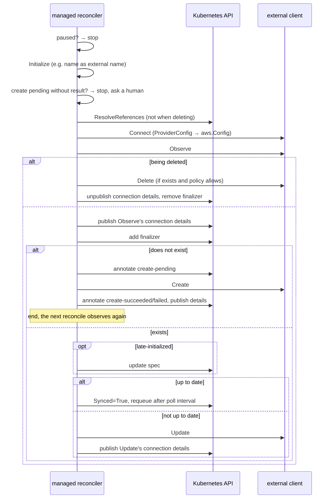

# crossplane-runtime v2

## What it is

[crossplane-runtime](https://github.com/crossplane/crossplane-runtime) is the
library every Crossplane provider builds on. Its **managed reconciler**
(`pkg/reconciler/managed`) implements the generic lifecycle of a managed
resource (MR); a provider only supplies an `ExternalConnector` and an
`ExternalClient` with four verbs: `Observe`, `Create`, `Update`, `Delete`.

## Why

It encodes Crossplane's contract (conditions, finalizers, external names,
connection secrets, management policies, pausing, safe creation) once for
all providers. v2 is required for Crossplane v2: namespaced MRs, typed
clients, no external secret stores
([ADR 0001](../adr/0001-new-native-provider-for-crossplane-v2.md),
[ADR 0002](../adr/0002-namespaced-resources-only.md)).

## How it is used

The generated `Setup` of every kind creates
`managed.NewReconciler(mgr, kind, opts...)` with the generated connector
(see [code-generator.md](code-generator.md)). `SetupGated` registers it
behind the **safe-start gate**: the controller starts only once its CRD
exists (`capabilities: [safe-start]` in `package/crossplane.yaml`), so a
Crossplane `ManagedResourceActivationPolicy` can activate kinds selectively.

### One reconcile

Simplified from `reconciler.go` (v2.4); every step can end the reconcile
with an error condition and a requeue.

Consequences for hook authors:

- **Observe runs every time**, also right after Create. It must be cheap and
  must not change anything in AWS.
- **Observe's connection details are published before Update.** Don't
  publish values in `postObserve` that Update still has to apply (e.g. a
  new password), or "changed" checks against the secret never fire; publish
  them from `postUpdate`. The publisher merges keys, so keys you leave out
  keep their old value.
- **Create must be idempotent-safe**: if the result can't be recorded, the
  `crossplane.io/external-create-pending` annotation blocks further creates
  until a human removes it. Set the external name before calling AWS (the
  default initializer uses `metadata.name`).
- **`ResourceUpToDate: false` means Update is called**; return a useful
  `Diff` string, it is logged and shown in events.
- **Late initialization** writes observed defaults into the spec once; only
  late-initialize fields that won't fight the user.

### Defaults you don't need to wire

The reconciler already uses `metadata.name` as the external name
(`NewNameAsExternalName`), resolves references
(`NewAPISimpleReferenceResolver`), manages the finalizer and publishes
connection details to local Secrets. Pass reconciler options in
`configure` only to change these.

### Conditions

| Condition | Set by |
|-----------|--------|
| `Synced` | the reconciler (success or `ReconcileError`) |
| `Ready` (`Available`, `Creating`, `Deleting`, `Unavailable`) | **hooks**, usually `postObserve` from the AWS status |

The generated controller sets `Creating` and `Deleting` only; a kind that
never sets `Available` never becomes Ready.

### Management policies

Enabled by default (`--enable-management-policies`). With `Observe` only, the
reconciler never calls Create/Update/Delete; hooks don't need to handle it.

## Pitfalls

- `xpv1.ResourceCredentialsSecret*Key` constants are gone in v2; use
  `awsclient.ResourceCredentialsSecret*Key`.
- `publishConnectionDetailsTo` and external secret stores don't exist in v2.
- Typed clients: `managed.TypedExternalConnector[*Kind]`; the type
  parameter of `managed.WithTypedExternalConnector[*Kind]` is often needed
  explicitly.
