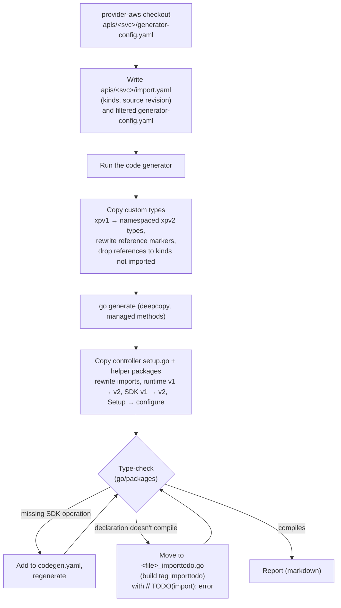

# Importer (`codegen/cmd/import`)

## What it is

A tool that ports managed-resource kinds from
[crossplane-contrib/provider-aws](https://github.com/crossplane-contrib/provider-aws)
(crossplane-runtime v1, AWS SDK v1, cluster-scoped) to this provider
(runtime v2, SDK v2, namespaced). It does the mechanical work and leaves a
compiling repository plus a list of what a human still has to port.

## Why

provider-aws contains years of hand-written behavior per kind (passwords,
restores, special drift rules). Rewriting it is slow and loses edge cases;
copying it by hand is error-prone. The importer makes porting repeatable,
and every fix to it helps the next kind
([ADR 0004](../adr/0004-import-kinds-from-provider-aws.md)).

## Flow



## Outputs

| Output | Meaning |
|--------|---------|
| `apis/<svc>/import.yaml` | Imported kinds, `ignoreFieldPaths`, and per kind the source `revisions` (repository, commit, `dirty`) |
| `apis/<svc>/generator-config.yaml` | Source config with every other kind ignored |
| `apis/<svc>/codegen.yaml` | SDK operations the ported code calls |
| `apis/<svc>/v1alpha1/custom_types.go`, … | Ported custom types and helpers |
| `internal/controller/<svc>/<kind>/setup.go`, tests | Ported controller code |
| `internal/clients/<svc>`, `internal/utils/*` | Ported helper packages (closure of what the controller imports) |
| `*_importtodo.go` | Code that still needs a human; excluded from the build |
| Report on stdout | Findings per file/topic: what was dropped, quarantined, not overwritten |

`revisions` are recorded only when a controller is ported fresh; existing
hand-written files are never overwritten, so a re-run keeps the old
revision. `dirty: true` means the source files of the kind had uncommitted
changes; the import is then not reproducible from the commit alone.

## Usage

```sh
cd codegen
go run ./cmd/import --source ../../provider-aws --service docdb --kinds DBCluster,DBInstance --output .. > /tmp/docdb-report.md
```

The full workflow, including porting the quarantined code, is the
[`import-kind` skill](../../.agents/skills/import-kind/SKILL.md).

## Design rules

- **The repository always builds.** Anything that doesn't compile is
  quarantined behind a build tag instead of failing the import.
- **Fix the importer, not its output**, when a fix is mechanical: the next
  kind needs it too. Semantic fixes (secret namespaces, restore flows) stay
  manual and go to [porting-notes.md](../porting-notes.md).
- **Never overwrite hand-written files.**

## Pitfalls

- References to kinds that are not imported are dropped with their
  `*Ref`/`*Selector` fields. Strings that name them (e.g. in
  `cmpopts.IgnoreFields`) still compile and panic at run time.
- The importer generates from the **current** SDK model, not the one
  provider-aws used; new fields appear and some may break generation
  (`ignoreFieldPaths`).
- Imported `isUpToDate` hooks compare a hand-picked subset of fields;
  rebase them on `DiffUpdatableParameters`
  ([code-generator.md](code-generator.md#drift-detection-diffupdatableparameters)).
