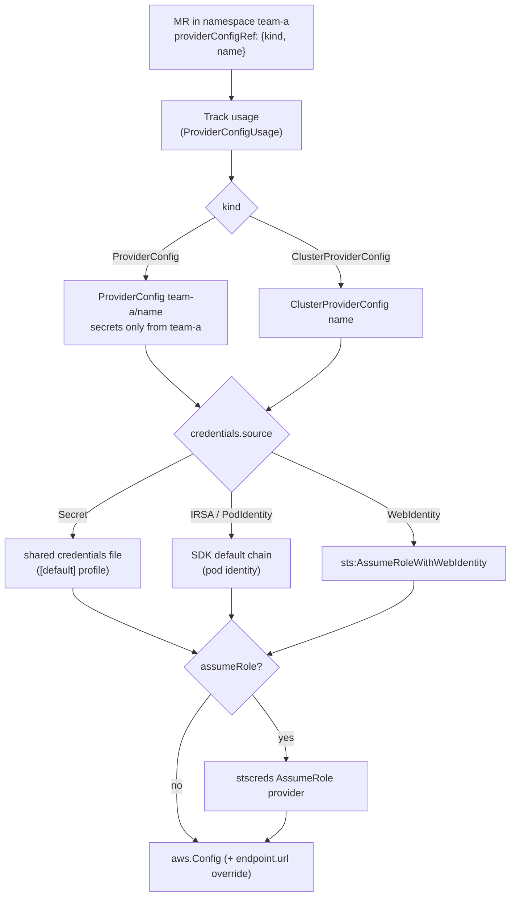

# ProviderConfig and AWS credentials

## What it is

A `ProviderConfig` (namespaced) or `ClusterProviderConfig` (cluster-wide)
tells the provider how to authenticate to AWS. Every managed resource
references one with `spec.providerConfigRef` (`kind` + `name`).
`internal/clients/aws` turns it into an `aws.Config` of the SDK.

## Why

- Crossplane v2 separates tenants by namespace: a team gets a namespaced
  `ProviderConfig` and can't use another team's credentials
  ([ADR 0002](../adr/0002-namespaced-resources-only.md)).
- Platform teams still need one shared config: `ClusterProviderConfig`.

## How it is used

Code path: `awsclient.GetConfig(ctx, kube, tracker, mr, region)` →
`GetProviderConfigSpec` → `NewConfig`. The generated connector calls it
with `spec.forProvider.region` (IAM: the global region).

**Usage tracking**: `GetConfig` records a `ProviderConfigUsage` per MR, so a
`(Cluster)ProviderConfig` can't be deleted while MRs use it
(`internal/controller/config`).

Example: [examples/provider/config.yaml](../../examples/provider/config.yaml).

## Secrets in general

All secret references in MRs are **local**
(`xpv2.LocalSecretKeySelector`, no namespace field) and are read in the MR's
namespace. Provider-owned helper secrets (e.g. the rds password cache) are
stored there too. Connection details go only to
`spec.writeConnectionSecretToRef` in the MR's namespace; the well-known keys
(`username`, `password`, `endpoint`, `port`) are constants in
`internal/clients/aws/connection.go`.

## Pitfalls

- A namespaced `ProviderConfig` may only use a Secret in its own namespace;
  `GetConfig` enforces this.
- `endpoint.url` overrides the endpoint for **all** services of the config
  (meant for LocalStack and tests).
